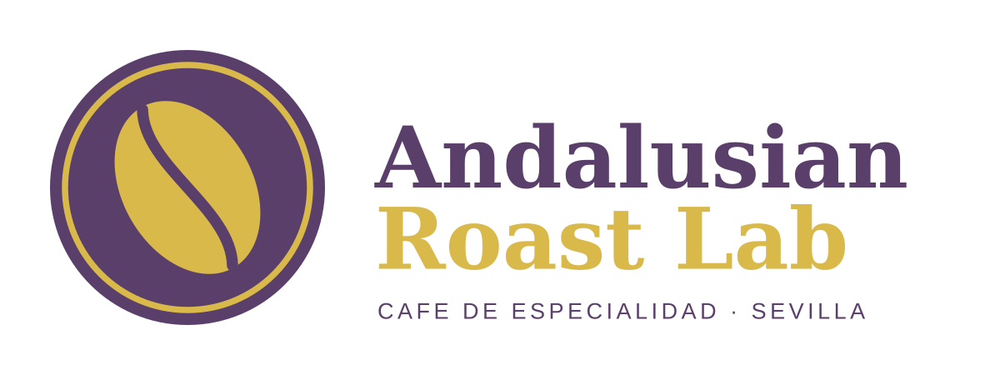

# SGE UD7: Odoo, usuarios, privilegios y venta completa

**Alumno:** Sandro Sanvicente Sánchez
**GitHub:** SandTrolilol14
**Empresa:** Andalusian Roast Lab S.L. (tueste de café de especialidad y equipamiento barista, Sevilla)

## Índice

| Apartado | Archivo |
|---|---|
| Empresa | [empresa/ficha-empresa.md](empresa/ficha-empresa.md) |
| Instalación (diapositiva) | [instalacion/instalacion-odoo.pdf](instalacion/instalacion-odoo.pdf) |
| Errores de instalación | [instalacion/errores-instalacion.md](instalacion/errores-instalacion.md) |
| Usuarios, grupos y permisos | [usuarios/usuarios-grupos-permisos.md](usuarios/usuarios-grupos-permisos.md) |
| Proceso de venta | [venta/proceso-venta.md](venta/proceso-venta.md) |
| Presupuesto impreso | [venta/presupuesto.pdf](venta/presupuesto.pdf) |
| Factura impresa | [venta/factura.pdf](venta/factura.pdf) |
| Capturas de apoyo | [capturas/](capturas/) |

## Resumen

- Odoo 19 Community instalado con Docker Compose en mi servidor, con una base de datos sin datos de demostración.
- Aplicaciones instaladas: Ventas, Facturación, Inventario y Contactos.
- Tres usuarios internos con mínimo privilegio (Sandro, Elena y Marcos), un usuario portal para un cliente y un grupo propio, «Andalusian Roast / Comercial junior».
- Proceso de venta completo con el usuario de cada rol: presupuesto S00001, entrega WH/OUT/00001 y factura INV/2026/00001 pagada.
