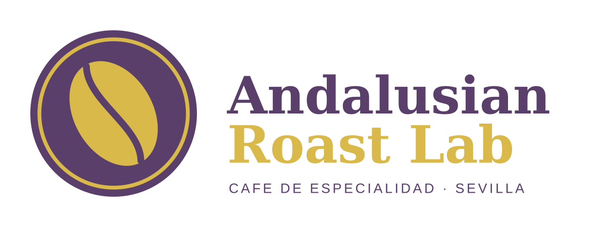

# Ficha de empresa: Andalusian Roast Lab S.L.

## Datos generales

| Campo | Dato |
|---|---|
| Nombre | Andalusian Roast Lab S.L. |
| Sector | Tueste de café de especialidad y equipamiento barista |
| NIF (ficticio) | B41098765 |
| Dirección | Calle Torneo 45, Polígono Artesanal, 41002 Sevilla, España |
| Correo | info@andalusianroast.es |
| Registro | Registro Mercantil de Sevilla, Tomo 4321, Folio 12 (ficticio) |
| Eslogan | Especialistas en tueste de café y equipamiento barista |
| Colores corporativos | Morado `#5b3f6b` y dorado `#d9b94a` |

## Actividad

Andalusian Roast Lab es una empresa sevillana que tuesta café de especialidad y vende equipamiento para baristas. Vende a hoteles, cafeterías y también a clientes particulares. Además del producto, ofrece un servicio de calibración y mantenimiento de máquinas.

## Catálogo

| Producto | Tipo | Precio de venta | Coste | Impuesto | Stock inicial |
|---|---|---|---|---|---|
| Café en Grano Etiopía Yirgacheffe (Paquete 1kg) | Almacenable | 28,00 € | 12,00 € | IVA 21 % | 100 |
| Cafetera Espresso Barista Pro 20 Bares | Almacenable | 185,00 € | 95,00 € | IVA 21 % | 25 |
| Portafiltros Naked (Sin Fondo) 51mm Acero Inox | Almacenable | 34,00 € | 14,00 € | IVA 21 % | 50 |
| Servicio de Calibración, Descalcificación y Mantenimiento | Servicio | 45,00 € | 15,00 € | IVA 21 % | no aplica |

Todos los productos tienen imagen.

## Clientes ficticios

| Cliente | Tipo | NIF | Correo |
|---|---|---|---|
| Gran Hotel Mirador del Guadalquivir S.A. | Empresa | A41000001 | compras@hotelmirador.example |
| Carlos Mendoza Gómez | Particular | no tiene | carlos.mendoza@correo.example |

## Configuración en Odoo

- Base de datos: `andalusian_roast_db`, creada sin datos de demostración.
- Aplicaciones instaladas: Ventas, Facturación, Inventario y Contactos.
- Diseño de documentos: plantilla `external_layout_bold`, con los colores corporativos y el pie con los datos de la empresa.
- Los documentos impresos (presupuesto y factura) llevan el logo y los colores de la empresa.
