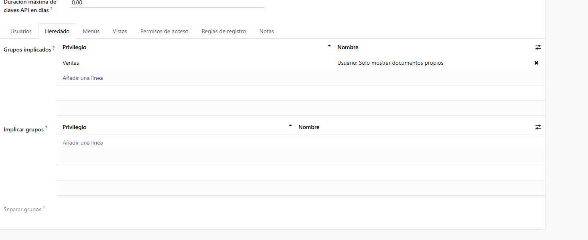
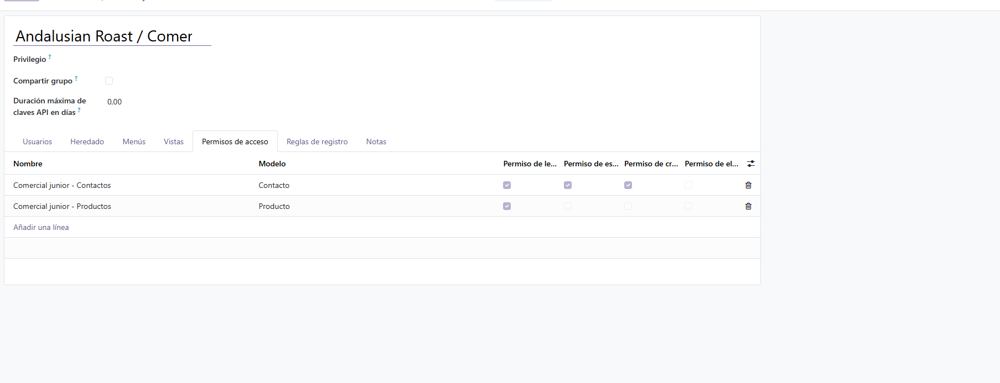
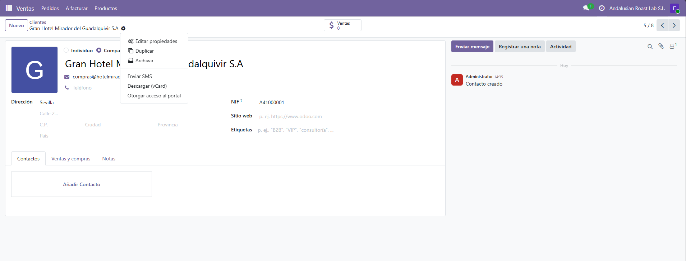
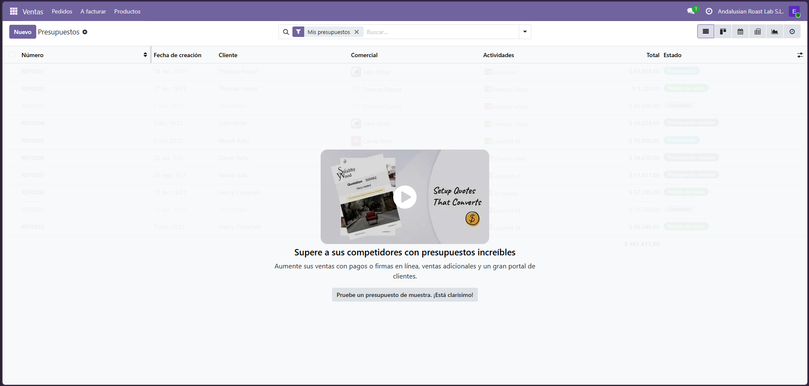
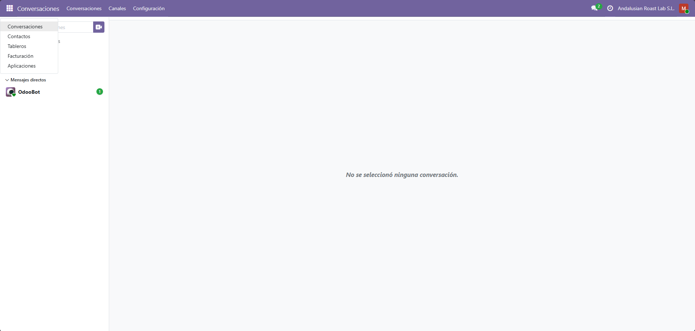
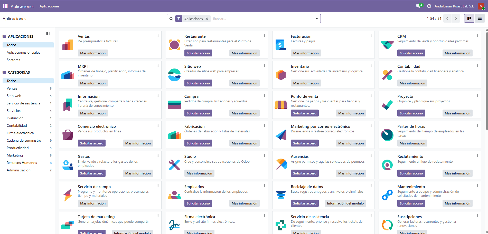
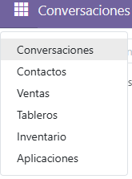
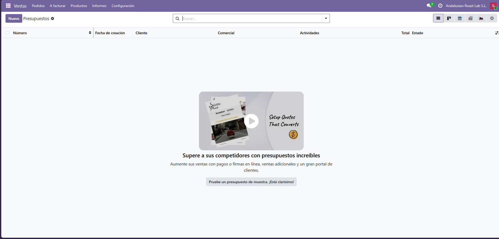
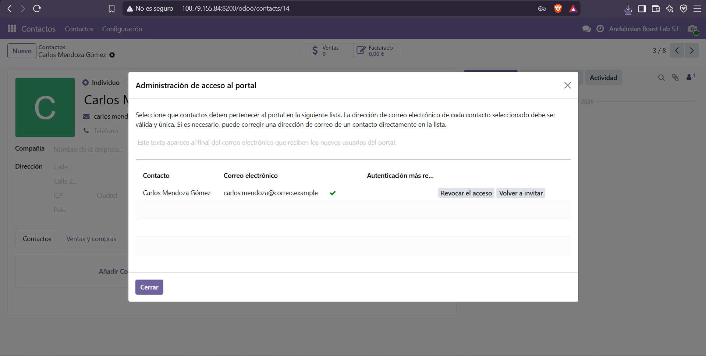

# Usuarios, grupos y permisos

Para la plantilla de Andalusian Roast Lab he aplicado el principio de mínimo privilegio: cada persona solo tiene los permisos que necesita para su puesto. Los tres usuarios son del tipo interno y tienen el rol base **Usuario**, no Administrador.

Por seguridad no incluyo contraseñas, solo los correos de acceso.

## Usuarios

| Usuario | Correo de acceso | Puesto | Tipo | Permisos por módulo | Justificación |
|---|---|---|---|---|---|
| Sandro Sanvicente | sandro@andalusianroast.es | Responsable de ventas | Interno | Ventas: Administrador · Inventario: Administrador · Contabilidad: sin acceso | Tiene que ver todos los presupuestos, confirmar pedidos y validar las entregas, pero no necesita contabilidad |
| Elena Gómez | elenagomez@andalusianroast.es | Comercial junior | Interno | Ventas: Usuario, solo documentos propios · grupo propio «Andalusian Roast / Comercial junior» · Contabilidad e Inventario: sin acceso | Solo crea y gestiona sus propios presupuestos |
| Marcos Ruiz | marcosruiz@andalusianroast.es | Administración / Facturación | Interno | Contabilidad: Facturación · Ventas e Inventario: sin acceso | Publica facturas y registra pagos, sin gestionar ventas |
| Carlos Mendoza Gómez | carlos.mendoza@correo.example | Cliente | Portal | Acceso al portal de clientes | Puede consultar sus propios documentos, sin acceso al sistema interno |

### Tipos de usuario

- **Interno:** es un empleado de la empresa. Entra a la aplicación y ve los menús según sus permisos. Es el caso de Sandro, Elena y Marcos.
- **Portal:** es una persona externa, normalmente un cliente o un proveedor. Solo ve sus propios documentos, como presupuestos y facturas. Es el caso de Carlos.
- **Público:** es un visitante anónimo, sin sesión iniciada. No lo he usado.

Sandro lleva mi nombre, como pide la tarea.

## Grupo propio: Andalusian Roast / Comercial junior

**Herencia (Grupos implicados):** Ventas → Usuario: solo mostrar documentos propios. Quien esté en este grupo recibe también ese permiso.

**Derechos de acceso sobre modelos:**

| Nombre | Modelo | L (lectura) | E (escritura) | C (creación) | B (borrado) |
|---|---|---|---|---|---|
| Comercial junior - Contactos | Contacto | Sí | Sí | Sí | No |
| Comercial junior - Productos | Producto | Sí | No | No | No |

El grupo permite al comercial leer, escribir y crear contactos, pero no borrarlos. Los productos solo puede consultarlos.

**Asignado a:** Elena Gómez.

## Comprobación de permisos

Para comprobar que los permisos funcionan, entré con cada usuario en una ventana de incógnito.

### Elena (comercial)
- Ve la aplicación Ventas, con un menú reducido (Pedidos, A facturar, Productos).
- En Presupuestos tiene activo el filtro «Mis presupuestos», así que solo ve los suyos.
- No ve Facturación ni Inventario.
- En la ficha de un cliente, el menú del engranaje **no ofrece Eliminar**. Solo Archivar, que se puede deshacer.

### Marcos (facturación)
- Ve Facturación y puede crear facturas.
- No ve Ventas ni Inventario.
- En Aplicaciones solo puede ver el catálogo: no puede instalar nada, solo «Solicitar acceso» al administrador.

### Sandro (responsable de ventas)
- Ve Ventas, con Informes y Configuración, e Inventario.
- No ve Facturación.
- En Presupuestos no tiene el filtro «Mis presupuestos», así que ve los de todos.

### Usuario portal
Carlos Mendoza Gómez tiene acceso al portal, concedido desde su ficha de contacto.

