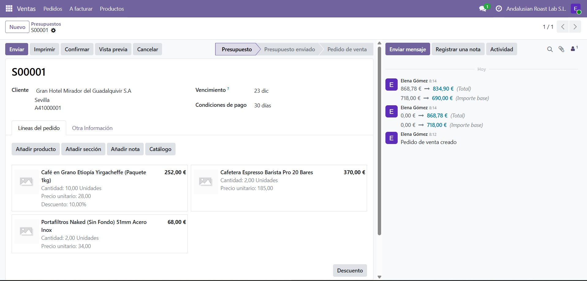
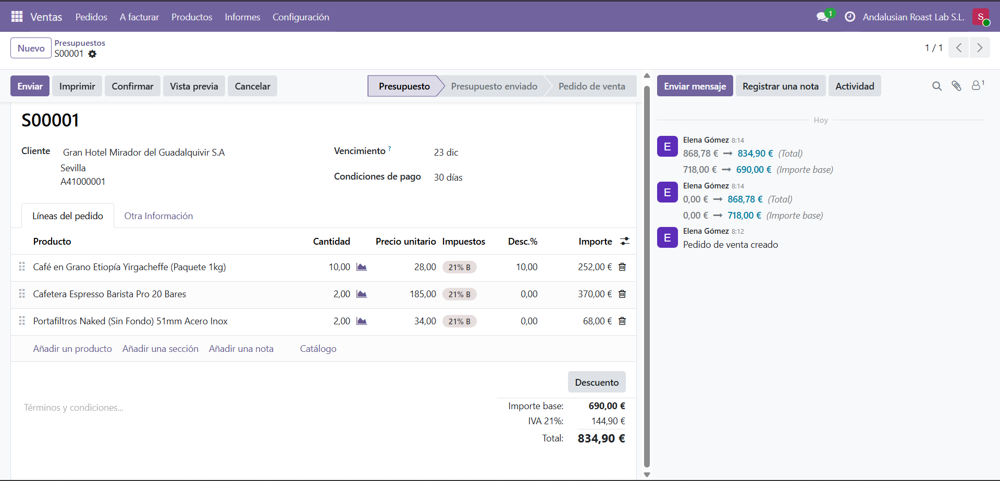
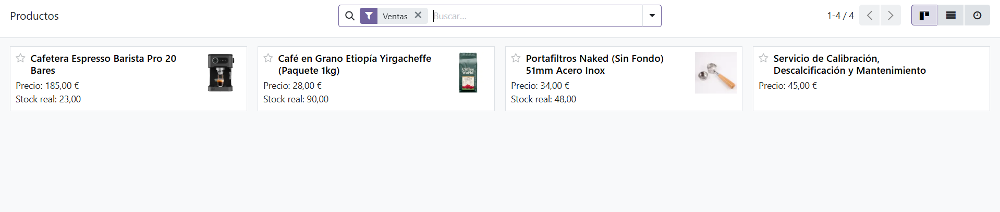
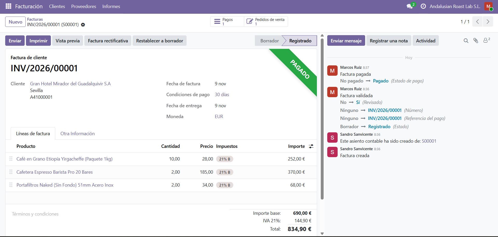
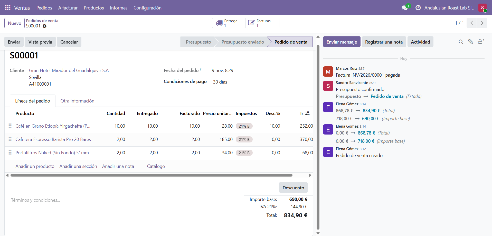

# Proceso de venta: del presupuesto a la factura

Cliente: Gran Hotel Mirador del Guadalquivir S.A. Cada paso lo hizo el usuario que le corresponde por su puesto, no el administrador.

## Pasos

| Paso | Usuario | Documento | Estado |
|---|---|---|---|
| 1. Crear el presupuesto | Elena Gómez (comercial) | S00001 | Presupuesto |
| 2. Confirmar el presupuesto | Sandro Sanvicente (responsable de ventas) | S00001 | Pedido de venta |
| 3. Validar la entrega | Sandro Sanvicente | WH/OUT/00001 | Hecho |
| 4. Crear la factura (borrador) | Sandro Sanvicente | INV/2026/00001 | Borrador |
| 5. Revisar y publicar la factura | Marcos Ruiz (facturación) | INV/2026/00001 | Registrado |
| 6. Registrar el pago | Marcos Ruiz | INV/2026/00001 | Pagado |

La factura la crea Sandro desde el pedido porque Marcos no tiene acceso al módulo de Ventas y no puede ver los pedidos. Marcos la revisa, la publica y registra el pago.

## 1. Presupuesto

- Tres líneas:
  - Café en Grano Etiopía Yirgacheffe (Paquete 1kg): 10 unidades a 28,00 €, con un 10 % de descuento (252,00 €).
  - Cafetera Espresso Barista Pro 20 Bares: 2 unidades a 185,00 € (370,00 €).
  - Portafiltros Naked (Sin Fondo) 51mm Acero Inox: 2 unidades a 34,00 € (68,00 €).
- Plazo de pago: 30 días.
- Fecha de validez: 23/12/2026.
- Importe base: 690,00 €. IVA 21 %: 144,90 €. **Total: 834,90 €**.

PDF impreso desde Odoo: [presupuesto.pdf](presupuesto.pdf)

## 2. Pedido de venta

Sandro confirmó el presupuesto y pasó a pedido de venta. Odoo generó la orden de entrega y el botón de facturas.

## 3. Entrega

Sandro validó la entrega WH/OUT/00001 con la cantidad hecha igual a la pedida. El stock bajó:

| Producto | Stock antes | Stock después |
|---|---|---|
| Café en Grano Etiopía | 100 | 90 |
| Cafetera Espresso Barista Pro | 25 | 23 |
| Portafiltros Naked | 50 | 48 |

## 4. Factura

Marcos publicó y pagó la factura INV/2026/00001 por 834,90 €. Queda en estado «Pagado» y con importe adeudado de 0,00 €.

PDF impreso desde Odoo: [factura.pdf](factura.pdf)

## Estado final del pedido

El pedido S00001 está en estado «Pedido de venta» con una entrega y una factura. En las líneas, la cantidad pedida, la entregada y la facturada coinciden (10, 2 y 2).

